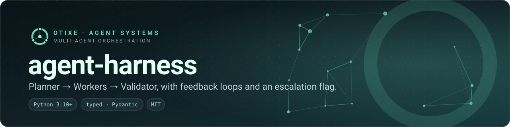
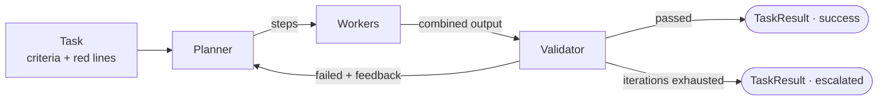
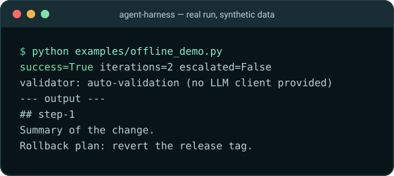

<p align="center">
  
</p>

<p align="center">
  <a href="https://github.com/otixe/agent-harness/actions/workflows/ci.yml"></a>
  <a href="LICENSE"></a>
  
  
</p>

**A small, dependency-light skeleton for multi-agent task execution with explicit roles.** One planner decomposes the task, workers execute the steps, and a *separate* validator decides whether the success criteria are met — with a bounded retry loop in between.

## The problem

A single agent that plans, executes and grades its own work tends to approve its own mistakes. "Call the model in a loop until it says it's done" has no stopping rule and no independent check. Running several agents without roles just moves the problem around.

## The approach

Make the roles explicit and give each its own model, prompt and client:

| Role | Responsibility |
| --- | --- |
| `Planner` | Decomposes a `Task` into `TaskStep`s, each assigned to a named worker, with `depends_on` links. |
| `Worker` | Executes one step, receiving the outputs of the steps it depends on as context. |
| `Validator` | Checks the combined output against the task's `success_criteria`. Can use a *different* model than the workers. |
| `Harness` | Runs the loop, feeds validator feedback back into the next iteration, stops at `max_iterations`, and reports `escalated=True` when you configured an escalation model and the loop did not converge. |



## See it run

The demo uses a scripted client, so it needs no cloud account and no key. The first pass omits a required section; the validator rejects it; the feedback is appended to the task; the second pass passes.

<p align="center">
  
</p>

<sub>Terminal capture of examples/offline_demo.py: success after two iterations, not escalated.</sub>

## Quickstart

Python 3.10+. Not on PyPI yet — install from GitHub:

```bash
pip install "git+https://github.com/otixe/agent-harness.git"
python examples/offline_demo.py     # after cloning, to see the loop without any model
```

Plug in your own model client. Anything with a `converse(messages, system_prompt) -> str` method satisfies the `LLMClient` protocol:

```python
from agent_harness import Harness, Planner, Task, Validator, Worker

class MyClient:
    def converse(self, messages, system_prompt=""):
        ...  # call your provider and return the text of the reply

client = MyClient()
harness = Harness(
    planner=Planner(model="planner-model", client=client),
    workers=[Worker(name="research", model="worker-model", client=client)],
    validator=Validator(model="validator-model", client=client),
    escalation_model="escalation-model",
    max_iterations=5,
)
result = harness.run(Task(
    description="Summarise the open incidents and propose next steps",
    success_criteria=["Every incident has an owner", "Next steps are ordered"],
    red_lines=["Do not modify infrastructure"],
))
print(result.success, result.iterations_used, result.escalated)
```

## Status and honest limits

This is a **reference skeleton**, not a finished framework. Know what is and is not there:

- Steps run **sequentially**, in the order the planner returns them; `depends_on` decides which outputs a step receives, it does not parallelise.
- With a client attached, `Planner.plan` and `Validator.validate` send the prompt but do **not** parse the reply yet — the planner returns a single step and the validator returns "validated". Parse your model's structured output there (the hooks are marked in `roles.py`). Without a client, the validator falls back to checking that each criterion appears in the output, which is what the demo and the tests use.
- `escalation_model` currently only sets `escalated=True` on the result; routing to a stronger model is yours to implement.
- `red_lines` are passed to the planner as text. They are **not enforced** in code.
- No Bedrock (or other provider) adapter ships in the package; the `LLMClient` protocol is the integration point.

If you need a provider-specific agent loop with tools and memory, see [bedrock-claude-starter](https://github.com/otixe/bedrock-claude-starter).

## Guidance from running agent teams

Not code, but the reasons the roles are split: use a validator that is not the model that produced the work; plan once per task rather than every turn; keep long single deliverables in the orchestrating thread instead of delegating them; write the red lines down. The [platform manual](https://github.com/otixe/plataforma) describes the full working method (separation of powers, proportionate gates, independent QA).

## Development

```bash
pip install -e ".[dev]"
ruff check src tests && mypy src && pytest
```

## Part of the Otixe agent platform

Otixe builds persistent, accountable agent teams: **Pi** (runtime) → **Oficinas** (persistent teams) ↔ **Cerebro** (shared memory and work state) ↔ **Sinapsis** (web control surface), with **AMA** connecting the runtime to Cerebro.

This library is a compact, standalone illustration of the platform's working method: separate execution from validation, bound the loop, keep the evidence.

[Otixe profile](https://github.com/otixe) · [Platform manual](https://github.com/otixe/plataforma) · [pi-oficinas](https://github.com/otixe/pi-oficinas)

## Validation

See [VALIDATION.md](VALIDATION.md) for the local Python matrix, reproducible checks and unproven integration boundaries. GitHub Actions has not been run by this delivery.

## License

MIT — see [LICENSE](LICENSE).
